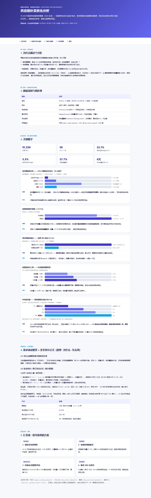

# Supply Chain — Replenishment Optimization

**The business problem.** Retail/manufacturing inventory sits between two
failure modes: **stock out (lost revenue)** and **over-stocking (tied-up
capital)**. On real inventory data (91,250 rows, 50 SKUs × 5 warehouses × 365
days, 2024), this project identifies *which* SKU/warehouse to watch and *how* to
replenish — safety stock and reorder point optimized by demand volatility and
lead time.

## Honest data boundary (read first)

This dataset is a **synthetic grid** (50×5×365, no missing values):
- **Stockout_Flag is all 0** — no positive samples → **a stockout classifier is
  impossible** here.
- **Demand_Forecast correlates 0.949 with Units_Sold** — demand is essentially
  already given; re-training a demand forecast would be self-deception.
So I do **no fake prediction**. This project delivers **inventory-health + 
replenishment decision support** instead, and says so plainly.

## What it does

- Derives inventory coverage (`Inventory/Reorder_Point`), daily demand,
  demand volatility (CV), and promotion lift.
- **Unsupervised clustering** (KMeans, no labels needed) on demand/volatility/
  lead-time/coverage → groups by lead time (short/mid/long, ~4/7/12 days).
- **Safety stock & reorder point** via the standard formulas `SS = z·σ·√L`,
  `ROP = d·L + SS` — explained, not magic.
- Ranks replenishment priority by `inventory − ROP` gap.

## Key verified numbers

- 22.1% of days have coverage ≤1.2 (near reorder point); 5.3% already below
- Median coverage 1.53 (healthy overall; stockouts are sporadic, not systemic)
- Promotions lift sales +27.7% (24.9 vs 19.5 units/day)
- All SKU×warehouse have CV>0.4 (high volatility); median CV 0.45
- SS median 41.8; ROP median 202.1; 0% below ROP on annual average

## Models / why not DL

KMeans clustering + statistical safety-stock formulas — tabular, 250 groups, no
labels; interpretable and directly deployable. **No DL**: no labels, needs to
be explainable to inventory teams, and tree/statistical methods already fit.

## 报告预览



> 完整交互报告：`报告/供应链补货优化分析.html` —— GitHub 不渲染仓库内 HTML，clone 后本地打开。

## Layout

```
scripts/ clean_data.py / analyze.py / ml_analysis.py
tests/   test_cleaning.py, test_report_numbers.py
报告/   供应链补货优化分析.html  (indigo-violet theme, each chart Insight+Action)
```

## 数据来源

原始数据在项目内 `data/raw/`（不入 git——clone 后请自行下载）。

| 文件 | 说明 | Kaggle 下载 |
|---|---|---|
| `supply_chain_dataset1.csv` | SKU×仓库×日期网格，91,250 行（2024） | `kaggle datasets download -d ziya07/high-dimensional-supply-chain-inventory-dataset -p data/raw --unzip` |

Kaggle 页面：https://www.kaggle.com/datasets/ziya07/high-dimensional-supply-chain-inventory-dataset

```bash
pip install kaggle
kaggle datasets download -d ziya07/high-dimensional-supply-chain-inventory-dataset -p data/raw --unzip
# 需要 kaggle.json / KAGGLE_USERNAME + KAGGLE_KEY 认证
```

— Jiawei Wang
