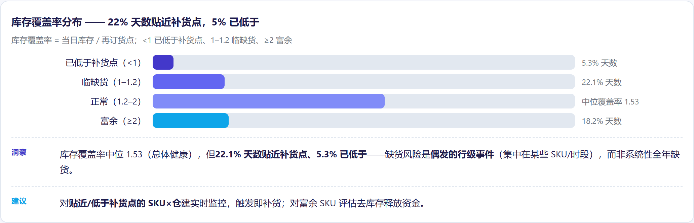
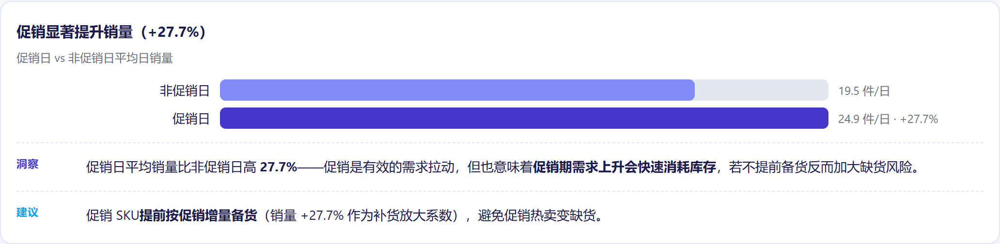
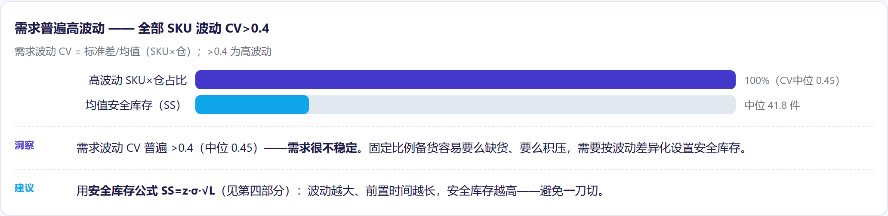
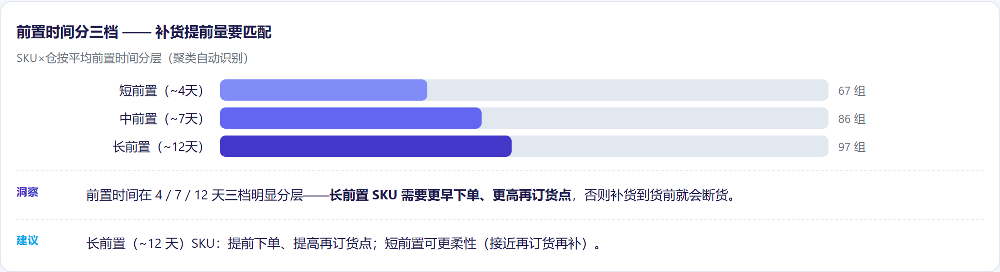
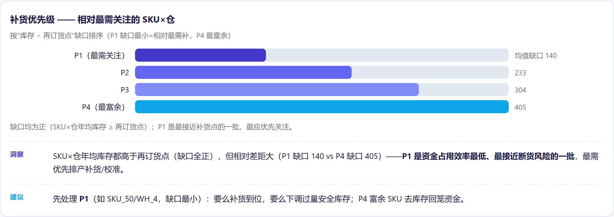

# 供应链补货优化分析（Supply Chain Replenishment Optimization）

> 项目目标：库存夹在两种失败之间——**缺货（丢收入）** 与 **超储（占用资金）**。在库存数据（91,250 行，50 SKU × 5 仓 × 365 天，2024）上识别**哪些 SKU×仓需要关注、该怎么补货**——用需求波动与前置时间优化安全库存与再订货点。
> 数据：真实库存网格数据（91,250 行，50 SKU × 5 仓 × 365 天，2024）。

## 一、业务背景与目的

零售/制造库存管理最怕两头：缺货丢销售、超储压资金。本项目用真实库存数据，识别"贴近补货点、甚至已低于"的 SKU×仓，并给出**安全库存 + 再订货点**的补货决策支持。

## 二、诚实数据边界（先读）

该数据集是**合成网格**（50×5×365，无缺失）：
- **Stockout_Flag 全部为 0**——无正样本 → 缺货分类器在此不可能。
- **Demand_Forecast 与 Units_Sold 相关 0.949**——需求本质已给定，再训练需求预测是自欺。

所以本项目**不做假预测**，改做**库存健康 + 补货决策支持**，并如实说明。

## 三、做了什么

- 派生库存覆盖率（`Inventory/Reorder_Point`）、日均需求、需求波动（CV）、促销提升。
- **无监督聚类（KMeans，无需标签）**：按需求/波动/前置时间/覆盖度分组 → 前置时间分三档（短/中/长，约 4/7/12 天）。
- **安全库存与再订货点**：用标准公式 `SS = z·σ·√L`、`ROP = d·L + SS`——讲清原理，不是黑盒。
- 按 `库存 − ROP` 缺口排序补货优先级。

## 四、图表







> 完整交互版报告：`report/供应链补货优化分析.html`——GitHub 不渲染仓库内 HTML，clone 后本地打开。

## 五、关键数字

- 22.1% 的天数覆盖率 ≤1.2（贴近补货点）；5.3% 已低于
- 覆盖率中位 1.53（整体健康；缺货是零散而非系统性问题）
- 促销提升销量 +27.7%（24.9 vs 19.5 件/天）
- 全部 SKU×仓 CV>0.4（高波动）；CV 中位 0.45
- 安全库存中位 41.8；再订货点中位 202.1；年均 0% 低于 ROP

## 六、建模 / 为什么不用深度学习

KMeans 聚类 + 统计安全库存公式——表格型、250 个分组、无标签；可解释、可直接落地。**不用 DL**：无标签、要对库存团队可解释、树/统计方法已够。

## 七、数据来源

原始数据在项目内 `data/raw/`（不入 git——clone 后请自行下载）。

| 文件 | 说明 | Kaggle 下载 |
|---|---|---|
| `supply_chain_dataset1.csv` | SKU×仓库×日期网格，91,250 行（2024） | `kaggle datasets download -d ziya07/high-dimensional-supply-chain-inventory-dataset -p data/raw --unzip` |

Kaggle 页面：https://www.kaggle.com/datasets/ziya07/high-dimensional-supply-chain-inventory-dataset

```bash
pip install kaggle
kaggle datasets download -d ziya07/high-dimensional-supply-chain-inventory-dataset -p data/raw --unzip
# 需要 kaggle.json / KAGGLE_USERNAME + KAGGLE_KEY 认证
```

## 八、运行方式

```bash
pip install -r requirements.txt
python scripts/clean_data.py
python scripts/analyze.py
python scripts/ml_analysis.py
pytest tests/ -q
```

## 九、目录结构

```
scripts/ clean_data.py / analyze.py / ml_analysis.py
tests/   test_cleaning.py, test_report_numbers.py
report/   供应链补货优化分析.html  （靛蓝紫配色，每个图表 Insight+Action）
```

— Jiawei Wang
